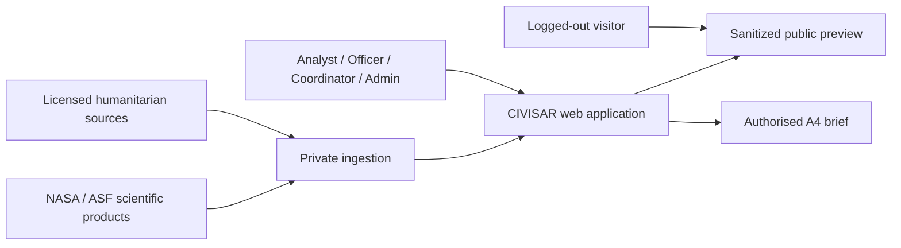
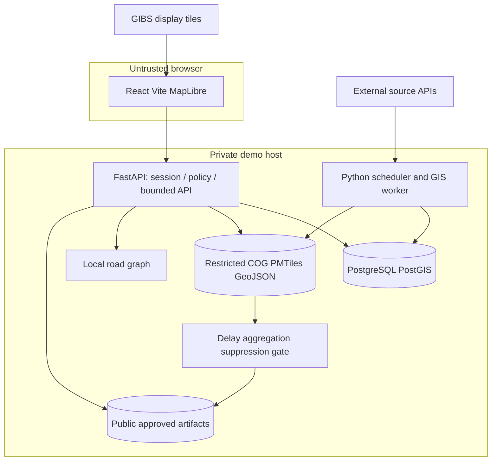
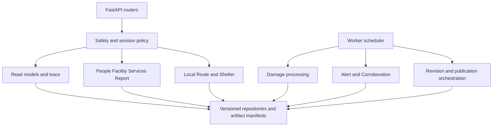
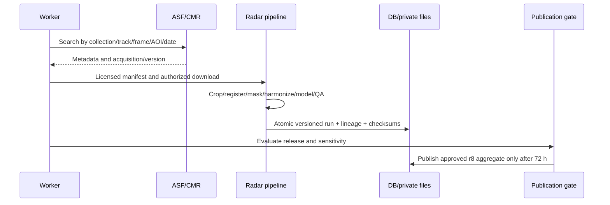
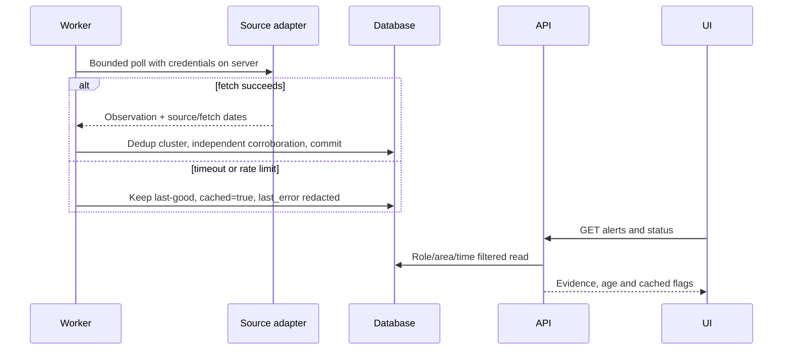
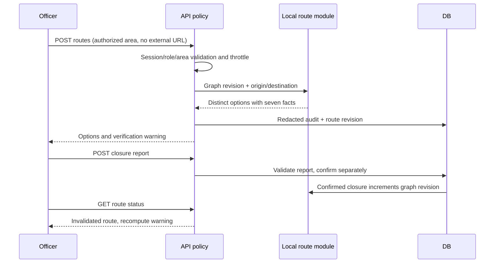
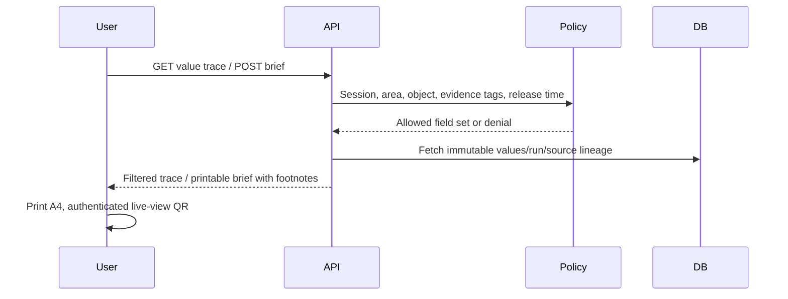

# Full system architecture

[Blueprint index](README.md)

Status: implementation blueprint, 14 November 2026. Source observations are the **13 November 2026 snapshot**, not fresh dataset verification. Unestablished implementation choices below are **ARCHITECT RECOMMENDATION (PROPOSED)**. No application or operational dataset was built in this planning task.


## Architectural baseline

Sources: ARCHITECTURE.md Parts 1–4, Shared by all parts; PROJECT_PLAN.md §8; UI_DESIGN.md §2.1. Use a simple modular monolith: React/Vite/MapLibre client; FastAPI API and a Python scheduler/worker sharing versioned domain modules; PostgreSQL/PostGIS; private filesystem artifacts. No microservice fleet or paid infrastructure. React client cannot confer authority on an endpoint or map file.

ARCHITECT RECOMMENDATION: cookie sessions, explicit area scopes, immutable processing runs, DB-backed jobs and publication views minimize integration overhead and provide a single enforcement point. Worker and API use different least-privilege DB accounts. All storage starts private; approved sanitized artifacts are promoted to a separate public directory.

## Context



## Containers and trust boundaries



GIBS requests reveal viewport to an external service. ARCHITECT RECOMMENDATION: for restricted route/shelter views use a pre-fetched licensed AOI background through the host, disable external geocoding/analytics, and avoid precise viewport requests to third parties. No route origin/destination crosses the server's routing boundary. Public-safe mode can use GIBS with a coarse fixed AOI and attribution. TLS tunnel is transport only, not authorization.

## Components and deterministic agents

| Function | Input → stored output | Accountable implementation | API/UI use |
|---|---|---|---|
| Damage | GCOV + masks + models → damage cells and QA | M1-02 | damage, time slider |
| Facility | HOTOSM + damage + dated reports → status | M2-02 | facilities, inspector |
| Services | lights/IODA/facilities → service evidence + needs | M2-02 | summary, needs row |
| People | baseline + damage fractions → ranges + severity parts | M2-02 | summary, people |
| Shelter | buildings/height/terrain/hazards → restricted candidates | M2-05 | shelters, field checks |
| Route | private graph/closures/hazards → options/revision | M2-04 | routes, turns |
| Movement | aggregate DTM/Meta → coarse delayed trend | M2-06 | stretch layer |
| Alert | new observations → deduplicated alerts | M2-03 | feed/detail |
| Corroboration | sources + lineage + temporal/spatial match → agreement | M2-03 | evidence details |
| Orchestrator | events/revisions → jobs/invalidation | M3-04 | freshness, changed closure |
| Report | trusted structured results → brief model | M2-02 | M3-03 API / M4-03 print |
| Safety | role/area/tags/release time → allow/filter/deny | M3-02 | every response/file/export |

Named functions share contracts; they are not autonomous conversational agents. A future LLM only explains trusted safe outputs and cannot invent numbers or transmit restricted context.



## Proposed monorepo (only docs exist now)

```text
dancing-with-the-sars/
  README.md                         existing, unchanged
  docs/                             references + this blueprint
    contracts/                      draft OpenAPI and synthetic examples
    tasks/                          exactly four member work packages
    adr/                            proposed decisions
  apps/web/src/{screens,components,api,mocks}     planned M4
  backend/app/{api,auth,policy,models,schemas}    planned M3
  backend/migrations/                           planned M3
  pipelines/{radar,geodata,alerts,routing,shelter} planned M1/M2
  worker/                                      planned M3
  tests/{unit,geo,api,security,e2e}              planned shared
  infra/{compose.yaml,proxy,ci}                 planned M3
  scripts/{preflight,load_demo,verify_demo}      planned M3
  data/{raw,staging,private,public,manifests}     ignored, never committed
```

## Processing DAG

```mermaid
flowchart LR
  Discovery[Discover scenes] --> Licence[Licence and access gate]
  Licence --> Manifest[Metadata checksum manifest]
  Manifest --> Download[Tiered download and AOI crop]
  Download --> QA[CRS time version nodata QA]
  QA --> Align[Register mask harmonize]
  Align --> Features[Built-up HH HV features]
  Features --> Model[Quiet-trained anomaly score]
  Model --> Review[QA reason codes uncertainty]
  Review --> Cells[H3 r9 stable area tables]
  Pop[Population facilities services] --> Cells
  Cells --> Raster[COG and tiles]
  Cells --> Vector[PMTiles and bounded GeoJSON]
  Cells --> API[Filtered API values]
  Raster --> API
  Vector --> API
  API --> UI[Map summary sources]
```



## Radar pass ingestion



## Live hazard alert



## Route and changed closure



## Source trace and brief export



Storage, API responses and presentation are distinct artifacts: raw features never automatically become browser fields. [Security](07_SECURITY_PRIVACY_AND_RBAC.md) defines per-resource filtering; [API](05_BACKEND_DATABASE_AND_API_CONTRACTS.md) defines shape; [UI](06_FRONTEND_DESIGN_AND_SCREEN_PLAN.md) defines display.
