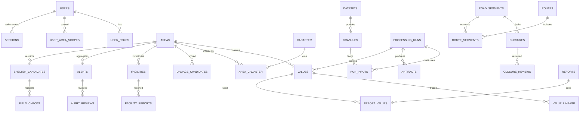

# Backend, database and API contracts

[Blueprint index](README.md)

Status: implementation blueprint, 14 November 2026. Source observations are the **13 November 2026 snapshot**, not fresh dataset verification. Unestablished implementation choices below are **ARCHITECT RECOMMENDATION (PROPOSED)**. No application or operational dataset was built in this planning task.

## API first at H2

Sources: ARCHITECTURE.md Agree at hour 2 and Part 3; PROJECT_PLAN.md §§8.1–10; UI_DESIGN.md §§2/6. [Endpoint inventory and examples](contracts/README.md) is the authoritative draft path/owner/role/parameter/response inventory. [OpenAPI draft](contracts/openapi.yaml) contains every inventory operation with errors and response examples. Freeze at H2 before parallel feature integration. M3 owns schemas/loaders/HTTP, M1/M2 supply domain outputs, M4 owns client and mock fixtures.

ARCHITECT RECOMMENDATION: `/api/v1` conventions, opaque IDs, ISO 8601 UTC timestamps, ISO dates only for day-level source data, SI units explicitly named, cursor pagination (default 25/max 100), RFC-style JSON errors with request ID and no sensitive internals. A response may be partial with explicit Unknown fields; no fabricated measurements. Non-essential payloads remain draft shapes in OpenAPI; actual domains must refine them at H2.

## Endpoint rules applied to every inventory row

Success payloads carry relevant evidence fields: values/alerts/route/shelter use `label,source,date,freshness,cached,safety_tag`; Layer uses source_ids plus acquired/processed/release timestamps; SourceRecord holds dataset provenance; status exposes only sanitized freshness. Collections retain per-item evidence. No unauthenticated trace may traverse into restricted granule paths or precise sites.

Errors: 401 absent/expired session, 403 role/area/object/tag/time denial, 404 permitted object not found, 409 stale graph/closure revision or unavailable requested source, 422 invalid bounds/mode/time, 429 limit with Retry-After, 503 source failed without cached state. Denied private objects do not reveal their coordinates, type details or existence through counts. GET `/api/v1/shelters` must return 401 anonymous and 403 analyst. Protected layer/file/print paths use identical policy.

Proposed per-user/IP budgets: auth 5 attempts/min then backoff; public 60/min; read 120/min; write 20/min; compute 10/min and one concurrent task; tiles 300/min with bounded tile count and maximum zoom approved for role. Route endpoints bound area to demo AOI and 3 alternatives; shelter limit ≤50; temporal queries ≤366 days unless admin job; bbox area ≤the demo AOI. Tune against measured demo behavior; never query the entire world by default. File IDs resolve from allowed manifests, never arbitrary paths or URLs. Range requests must pass the same checks and cannot span another private artifact.

## Proposed relational schema

Proposed freshness thresholds distinguish source acquisition age from successful polling: FIRMS/IODA last successful fetch ≤45 min Fresh, ≤2 h Aging, otherwise Stale; Black Marble newest usable acquisition ≤36 h Fresh, ≤72 h Aging, otherwise Stale. Radar shows acquisition age and expected next pass explicitly; a known acquisition gap is not a fetch failure. Radar freshness uses the published expected pass + processing allowance when available, otherwise Unknown schedule, not a fabricated 12-day arrival. Cached=true can coexist with any age class. These are demo engineering defaults to review at H2, not provider latency guarantees.

All choices here are ARCHITECT RECOMMENDATION. UUID primary keys except H3 area IDs and source-defined immutable keys. `created_at`, `updated_at`, schema_version and provenance FK are required where applicable. Foreign keys enforce referential integrity. Decimal/numeric values use explicit units and CHECK(low <= high) when both non-null.

| Table | Key fields and constraints | Index/use |
|---|---|---|
| users, roles, user_roles, user_area_scopes, sessions | user_id, password_hash, enabled; role enum; area_id; hashed session token, expires_at, revoked_at | unique username; session hash lookup; scoped authorization |
| areas, cadaster, area_cadaster | area_id H3 string, resolution 8/9, parent_id, geom; admin codes; intersection_share | GiST geom; unique H3/resolution; FK parent; fractional joins sum check |
| datasets, source_versions | dataset_id, provider, product, CMR, mark, terms_url, approved_uses; immutable source version | source family/version unique; licence approval gate |
| granules | granule_id, dataset_version_id, start/end, track/frame, processor, CRS, bbox, checksum, private_uri | GiST bbox; acquisition B-tree; dataset+external_id+version unique |
| processing_runs, run_inputs, artifacts | run_id, algorithm/code/parameter hashes, status, QA; input granules; checksum,path,tag,release_at | idempotency unique; run/status index; no client path access |
| values, value_lineage | value_id, area_id, metric, low/high/unit, label, source/date/tag, run_id, validity period | area/metric/date index; run FK; lineage DAG cycle rejection |
| damage_candidates | area_id, pass_pair, score, candidate_class, reason_codes, valid_pixel_count, run_id | area/pass unique per run; no confirmed collapse label |
| facilities, facility_reports | inventory geometry/type; report status, observed_at, reporter, evidence | GiST geom; report chronology; separate inventory/operating status |
| service_dependencies | from/to facility or area, service, evidence_id, confidence/validity | only verified/reported edges; no proximity-derived certainty |
| road_segments, closures, closure_reviews | segment geom/access/bridge, graph_revision; report versus confirmed, validity | GiST geom; segment/revision; append-only reviews |
| observations, alerts, alert_evidence, alert_reviews | source event key, area, detected_at, status, label, release_at; independent families | event key unique; time/area; no duplicate rehost upgrade |
| shelter_candidates, field_checks | private geom, access_tag, capacity assumptions/ranges, state, run_id; check requests | GiST private geom; coordinator scope; no public copy |
| routes, route_segments, route_audit | private origin/dest/geometry, graph/closure revision, owner scope, expiry; redacted audit | scoped user/area; segment join for invalidation |
| freshness_status, jobs | last acquisition/process/success/error, age class,cached; next_due,lease,idempotency | source/job unique; bounded retry and lease expiry |
| reports, report_values | author, area, source run snapshot, role policy version, expiry, content hash | report ACL re-evaluated at export; no long-lived unguarded link |
| audit_events | actor, action, coarse resource type, outcome, timestamp, request_id | append-only restricted; no coordinates/tokens/raw request bodies |

## ERD

## Data loading and publication

M3 validates manifests/schemas/checksums and transactionally inserts run + results + lineage. Geometry validation rejects wrong CRS, empty/malformed shapes and unexpected AOI. Explicit projection precedes distance/area calculation. Public view is a precomputed r8 materialization stripped of shelters, exact critical infrastructure, dispatch/route details and identifiable concentrations. Aggregation alone is insufficient: suppression/manual protection review is required. Public derivatives never embed r9 source geometries in metadata.

No app migration, database instance or endpoint was implemented during planning. Target implementation commands and test paths appear in [onboarding](15_TEAM_ONBOARDING.md); they must not be reported as successful until the app exists.
