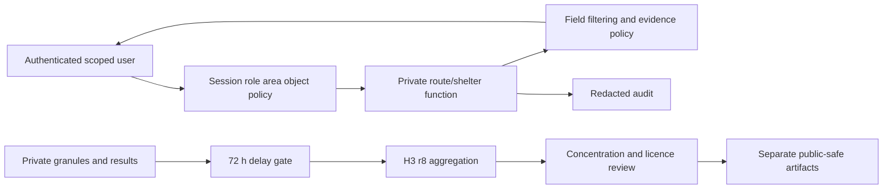

# Security, privacy and RBAC

[Blueprint index](README.md)

Status: implementation blueprint, 14 November 2026. Source observations are the **13 November 2026 snapshot**, not fresh dataset verification. Unestablished implementation choices below are **ARCHITECT RECOMMENDATION (PROPOSED)**. No application or operational dataset was built in this planning task.

## Non-negotiable protection rules

Sources: PROJECT_PLAN.md §§9–10; ARCHITECTURE.md §3.3; UI_DESIGN.md §§5–6; DATA_AND_API_PLAN.md §4; PDF p2 §4. Civilian humanitarian use only. Exclude military sites, frontline information, targeting, live people/phone/vehicle/convoy tracking. Do not publish shelter/displacement sites, exact routes/dispatch reports, identifiable civilian concentrations or an inventory of undamaged critical infrastructure. No field-use assurance follows from a hackathon pass.

## Role and resource matrix

ARCHITECT RECOMMENDATION: cumulative functional capabilities below, always intersected with explicit area scope and resource tags. Admin is not a bypass for publication delay, licensed access or object scope. Team leader must assign actual names later; no real accounts are provisioned by planning.

| Resource/action | Anonymous | Analyst | Officer | Coordinator | Admin |
|---|---|---|---|---|---|
| Sanitized r8 public preview, safe source catalogue/status | Yes | Yes | Yes | Yes | Yes |
| Scoped damage/people/services/alerts/validation | No | Yes | Yes | Yes | Yes |
| Exact critical-site inventory | No | Need-to-know subset only | Scoped operational subset | Scoped operational subset | Scoped only |
| Routes and closure reports | No | No | Yes | Yes | Yes |
| Confirm closure (separate review) | No | No | No | Yes | Yes |
| Shelter coordinates/capacity/field checks | No | No | No | Yes | Yes |
| Area brief / print / source trace | No | Own permitted sections | Own permitted sections | Own permitted sections | Own permitted sections |
| User roles, jobs, redacted audit | No | No | No | No | Yes |

Every endpoint and every file performs: authenticate → capability → area scope → object tag/licence → release time → projection/field filtering. A guessed ID, alternate download URL, Range request, HEAD request, PMTiles range, COG tile, GeoJSON, brief, trace or cache hit must not bypass policy. Deny default. No storage folder is directly mounted by a public static server. Policy runs before fetching restricted object data; errors/logs are scrubbed.

## Publication delay and suppression

For newly published strike-related change, `release_at >= acquisition_end + 72 hours`; API, tiles, derived alerts, reports and source trace enforce the same UTC gate. Unknown acquisition time means hold, not immediate release. Late processing cannot reduce the minimum delay. Restricted operational field reports have separate role policy; they cannot publish withheld radar evidence through a derivative. Default deny precise public buildings even after 72 h.

Public publication requires r9→r8 aggregation, removal of precise geometry and sensitive fields, licence approval and humanitarian protection review. H3 r8 alone can still identify concentrations: suppress small/unique/high-risk cells and revealing differencing across successive snapshots. ARCHITECT RECOMMENDATION: no automatic population or facility layer publication until Member 3 reviews the sanitized demo with Member 2; use synthetic public cells if a safe threshold cannot be justified. Never pretend a fixed population threshold guarantees protection.

## Sessions and server secrets

ARCHITECT RECOMMENDATION: server-side sessions using random opaque token stored hashed, HttpOnly/Secure/SameSite=Lax cookie, short idle timeout and eight-hour maximum demo session. Local HTTP development may use an explicit nonproduction insecure-cookie setting only on loopback. Login rate limiting and session rotation; logout/revocation invalidates all cached permissions. Use password hashing with a maintained library; credentials supplied locally, no committed default working passwords. Mutation endpoints require CSRF token and Origin check; CORS allowlists exact app origin. Production needs reviewed identity lifecycle/MFA.

Earthdata/FIRMS/ACLED/DTM credentials live only in server environment or secret store. `.env.example` contains empty placeholders. No `VITE_` secret variables, browser tokens, source maps with sensitive fixtures, credentials in Git, screenshots or request logs. FIRMS key may be in URL path; redact upstream request paths too. SQL parameter binding, input schemas, bounded geometry/time queries, no arbitrary remote URLs, allowlisted source fetch destinations and archive path validation prevent injection/path traversal/SSRF. Separate DB migration, API and worker credentials.

## Sensitive flow and threat checks

Threats: IDOR across areas; analyst requesting shelter in summary/brief/trace; guessed PMTiles file; CSRF closure submission; role downgrade with stale cache; external routing/map telemetry; response-size/bbox abuse; source poisoning; leaked debug logs; fine-resolution time differencing. Tests in T-RBAC/T-LAYER/T-CACHE/T-DELAY/T-SAFETY exercise these, with synthetic data only.

## Retention and cache design

ARCHITECT RECOMMENDATION pending data owners: no sensitive real operational data in the hackathon. If later authorized, expire route request details within 24 h, briefs/private artifacts at event-defined expiry, audit metadata after 30 days unless terms require shorter/longer retention. Retention dates and deletion jobs require owner review before ingestion; no deletion is performed by this plan. Raw licensed data retention follows source terms. Backups inherit encryption, ACLs and expiry; deletion must cover copies and caches. Preserve non-sensitive manifests/checksums for reproducibility without retaining prohibited content.

Protected API/files `Cache-Control: private, no-store`, no CDN caching, service worker bypass, no signed URLs that outlive role revocation. Shared proxy caches key by public publication version only. Clear client state on logout/role change; refuse stale restricted saved routes. Public offline shell may cache only approved sanitized assets. No restricted data enters external LLMs; future fixed-question helper cannot send user-entered sensitive coordinates either.

## Required deny demonstration and operational warning

Anonymous `/api/v1/shelters` → 401. Analyst same path, capacity POST, guessed detail via field-check path, summary expansion, file, trace and print → 403 or authorized payload with shelter fields absent. Officer has route rights but still cannot retrieve shelter coordinates; coordinator can only in permitted area. Same role in other area → 403. This must be server evidence, not just a hidden button.

UI and briefs: “Candidate for checking. Field verification required.” Remote sensing cannot prove route passability, operating services, structural integrity or absence of explosive ordnance. Production deployment requires humanitarian protection and scientific expert validation beyond hackathon acceptance. No paid hosting, real deployments or external dispatch messages were authorized or performed in this planning work.
