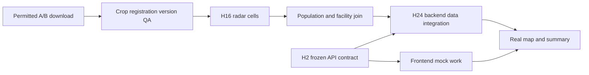

# 48-hour development roadmap

[Blueprint index](README.md)

Status: implementation blueprint, 14 November 2026. Source observations are the **13 November 2026 snapshot**, not fresh dataset verification. Unestablished implementation choices below are **ARCHITECT RECOMMENDATION (PROPOSED)**. No application or operational dataset was built in this planning task.

## Milestones and go/no-go gates

Source: ARCHITECTURE.md Putting it together/Timeline, Parts 1–4 handoffs, de-scope order; user request §8. This is the future development weekend, not work already executed by this planning task. No radar download starts during planning.

| Window | Accountable gate owner | Exact outputs by member | Dependency | Test gate | Go/no-go |
|---|---|---|---|---|---|
| H0–H2 | Member 3 | M1 manifests/account preflight; M2 source register/H3 IDs; M3 Compose/contracts; M4 app+fixture shell | Clean branch, available tools, source rights and rules review | T-DATA/T-LICENCE/T-CONTRACT | H2: version 0.1 row/API/file contract acknowledged by all four; otherwise block divergent feature work, continue fixtures |
| H2–H8 | Member 1 | Radar crop/registration QA; M2 grid and baseline; M3 PostGIS/session; M4 mock main map | M1-01 and H2 contract | T-GEO/T-RADAR/T-SQL | Common valid before/after pixels and version metadata present; otherwise synthetic demo declared and real radar gate remains blocked |
| H8–H16 | Member 2 | M1 first damage cells; M2 road graph/live adapter callables; M3 mock endpoints/scheduler; M4 time slider/feed | H8 data + contract | T-ML/T-ALERT/T-CONTRACT | H12 grid/facilities and mock auth; H16 M1→M2/M3 cells validated; failures retain Unknown and documented fallback |
| H16–H24 | Member 3 | M1 COG/pass index; M2 people/shelter/alert joins; M3 real loads; M4 summary/alert detail | H16 artifact manifests | T-PEOPLE/T-FACILITY/T-SHELTER/T-TRACE | H24 real-data vertical slice from one valid NISAR pair through map. If absent, explicit reduced synthetic walkthrough, no real-data success claim |
| H24–H32 | Member 3 | M1 model QA/optional cross-check; M2 route alternatives/closure revision; M3 protected endpoints; M4 routes/shelters/Sources | H24 slice, source permissions | T-ROUTE/T-RBAC/T-LAYER/T-ML | H32 exact-role denial and local routing pass; no external link if privacy gates fail |
| H32–H38 | Member 4 | Security/fixture-real audit, responsive/print, freshness, full rehearsal | All MVP tasks | T-E2E/T-A11Y/T-BRIEF/T-CACHE | H38 feature freeze; privacy/provenance blockers prevent publication. Optional work only ships if already green |
| H38–H44 | Member 4 | Fixes only; backup restore M3; model/source caveat review M1/M2; record video H40–44 | Frozen build and rehearsed script | T-DEVOPS/T-E2E | Backup laptop or recorded demo works without external APIs; no new optional feature |
| H44–H48 | Member 4 | Submission text/video, dataset citations, repository/security/accessibility checklist, release candidate | H44 backup and citations | T-SUBMIT/T-LICENCE/T-SAFETY | Tag only tested reviewed commit; unresolved validation/hosting disclosed to judges; team release decision recorded |

## First two hours

H0–H0.5: M3 confirms clean clone/dev history and tooling, M1 metadata and Earthdata access, M2 rights/coverage and small source manifests, M4 written UI/reference accessibility. Recheck current challenge preparation rules; no assumption that pre-downloading is allowed. H0.5–H1: start A then B downloads only in actual development; M2 makes grid/schema fixture, M3 starts DB/session stub, M4 renders labelled synthetic base map. H1–H2: all four review area IDs, canonical rows, units, CRS, artifact names, eight mock JSON shapes and denial cases; M3 publishes contract v0.1, M4 consumes it. Unresolved data facts remain VERIFY and do not become implicit schema values.

## Critical path

The API contract itself freezes before radar work finishes. The later critical-path API step is loading real data into that agreed contract. Blocking M1→M2 delivery threatens population estimates and the map, so M2/M4 work against the same small fixture early.

## Resource budgets (estimates, not benchmarks)

Source radar sizes: A 7.7 GB + B 6.8 GB = 14.5 GB must-have; C ~15 GB optional. At 20 Mbit/s, payload-only 14.5 GB takes about 1.6 h; protocol/retries can lengthen it. ARCHITECT RECOMMENDATION: reserve 50 GB free for A/B, crops/temporary files/DB; 80–100 GB if tier C retained. Confirm actual size/free disk before download; skip tier C if budget fails. Crop and stream in windows; share only authorized cropped outputs. Target a laptop with 16 GB RAM and 4 CPU cores, one radar processing job at a time, limit tile conversion memory; no GPU requirement or unmeasured speed promise. Keep a 4–8 GB worker memory budget initially and record runtime/RSS on first crop. PostGIS + API + web share host; rates are bounded by demo AOI, not global scale.

## De-scope and contingency

Cut optional LLM first, then coherence, then responsive/print polish (retain usable field views and printable brief), then open-land shelters (keep buildings), then later passes after July (retain real before/after and honest gaps). Every cut updates feature status and acceptance report. Never remove NISAR demonstration, sign-in/roles, provenance, public delay/aggregation or safety. Loss of scientific data cannot be hidden by screenshots: demonstrate synthetic behavior with a visible label, record real-data MVP as blocked, and show the metadata/validation blocker.

Source outages: last-good timestamped Cached result; no previous result → Unknown/unavailable. No credentials: use no-network fixtures, do not report API success. Hosting fails: localhost and recorded backup. Security fails: no public link; do not waive checks to meet submission. Validation unavailable: no UNOSAT overlay, no accuracy claim; report independent scientific QA honestly.

Stretch and post-hackathon items are exhaustively assigned in [scope inventory](01_REQUIREMENTS_AND_SCOPE.md). No new stretch feature starts after H38, resolving the source's contradictory “stretch only after H38” line through D16.
