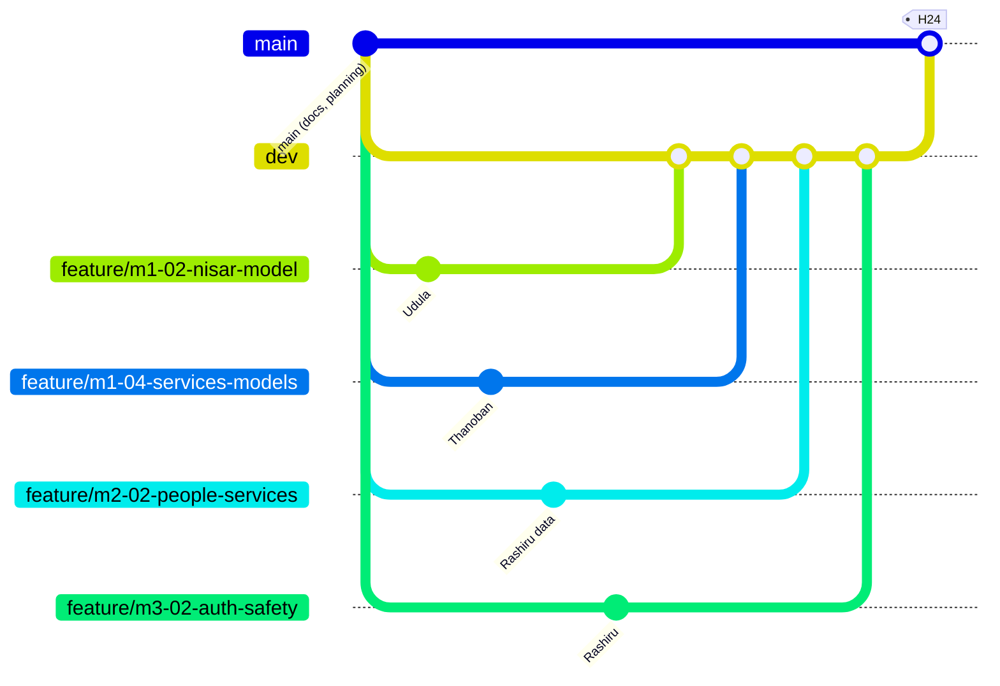

# Team assignment and branch plan

[Blueprint index](README.md)

Decided 14 November 2026. This is the single source of truth for who does what and how Git is used. It replaces the anonymous "Member N" split. The full task details stay in the four task files.

| Member slot | Person | Role |
|---|---|---|
| Member 1 | **Udula** | ML: NISAR damage model end to end. **All large radar downloads** and model training on the strong machine |
| Member 2 | **Thanoban** | ML on small data: night-light power-loss model, fire event model, strike-enrichment tests. Trains on free Google Colab ([plan](18_THANOBAN_ML_PLAN_AND_COLAB.md)). No backend, no radar downloads. Demo, video and submission from H38 |
| Member 3 | **Rashiru** | **All frontend, all backend and all data work** (with Claude Code and Claude Design), and **manager of all PRs** |
| Member 4 | **Chames** | No tasks assigned (14 Nov 2026). Standby: first candidates to take from Rashiru are data tasks M2-01 to M2-05 and worker/hosting M3-04 |

## ML rules

1. **Split by dataset, not by stage.** Each ML person owns their model end to end. No "one downloads, the other preprocesses".
2. **All large downloads are Udula's.** Thanoban never downloads radar files. He works only with small data: Black Marble night lights, FIRMS fires, ACLED and Insecurity Insight points, and the small damage table and crops Udula shares.
3. **Workload is divided evenly**: about 25 h (Udula) and 22 h (Thanoban).
4. Both write outputs in schemas fixed at H2, and use the `h3` library directly, so neither waits on the other or on Rashiru. Thanoban waits on Udula's damage table only for the final run of his tests (mock until H16).
5. A second radar model on Sentinel-1 is **not** in the core. It is a stretch task for Udula's machine only.

## Who does which task

Task IDs (M1 to M4) are work-package IDs. Each task has one owner and one different reviewer.

| Person | Tasks | About hours |
|---|---|---|
| **Udula** | M1-01 NISAR scenes, download, crop · M1-02 alignment, features, anomaly model, damage classes, change images (stretch: GSLC coherence) · M1-03 hold-out tests and top-20 eye check | 25 |
| **Thanoban** | M1-04 night-light power-loss model, fire event model, strike-enrichment and false-alarm tests (for the damage models) · M2-06 movement design · demo story, video and submission (H38–H48, part of M4-04) | 22 + demo |
| **Rashiru** | **Backend:** M3-01 formats, database, mock API · M3-02 sign-in, roles, safety (never cut) · M3-03 all endpoints · M3-04 worker, Docker, tunnel · **Data:** M2-01 base data and grid · M2-02 people, facilities, services · M2-03 alert plumbing · M2-04 routes · M2-05 shelters · **Frontend:** M4-01 app setup · M4-02 main map and slider · M4-03 decision screens and print · M4-04 phone layout, QA, release checklist | about 85 (too much for one person: see the cut order in 08) |

Reviews (each task has a different reviewer): Udula and Thanoban review each other's ML. Rashiru's tasks are reviewed by Thanoban (data, alerts, routes, shelters, app setup, main map) and by Udula (backend, safety, decision screens, QA). Udula's tests (M1-03) are reviewed by Rashiru. Rashiru merges all PRs; his own PRs are merged after one of the two ML members approves.

## Branch plan



| Branch | Purpose | Who may push |
|---|---|---|
| `main` | Demo-ready only, tagged | Nobody directly. Rashiru merges `dev` into it at H24, H38, H48 |
| `dev` | Integration branch: everything merges here first | Nobody directly. PR merges by Rashiru |
| `feature/<task-id>-<short-name>` | One task, short-lived (about 4 to 6 h) | The task owner |
| `docs/<name>` | Documentation changes | Anyone, by PR |
| `fix/<short-name>` | Fixes only, after the H38 freeze | Anyone, by PR |

### Rules

1. **One branch per task**, created from `dev`, deleted after merge. Example names: `feature/m1-01-nisar-download` (Udula), `feature/m1-04-services-models` (Thanoban), `feature/m2-02-people-services` (Rashiru), `feature/m3-02-auth-safety` and `feature/m4-02-main-map` (Rashiru).
2. **No direct pushes to `main` or `dev`. No force pushes. No `reset --hard`.** Branch protection needs repo admin, so Rashiru or the repo leader switches it on.
3. **PRs go into `dev`.** Small, one task, using the PR template below. One approval from someone other than the author, checker and tests green, then **Rashiru merges** with squash merge.
4. **`dev` to `main`** only at checkpoints, by Rashiru, with a normal merge commit: **H24** (real data), **H38** (feature freeze, tag `v0.1.0-demo-rc1`), **H48** (final, tag `v0.1.0-demo` after review).
5. **Stay current:** merge `dev` into your branch at least once a day and at H2, H8, H16, H24, H32.
6. **After the H38 freeze:** only `fix/*` branches, one reviewer, no new features.
7. **No big data in Git.** Radar scenes, crops, model weights and large tables stay on Udula's machine and shared storage. Git holds code, small manifests in `data/manifests/` and checksums. `.gitignore` already blocks the big files. Thanoban's laptop never needs radar files.
8. **Commits** use the author's own name, mention one task ID, and have no AI co-author line.
9. **Conflicts:** review both sides with the owner and rerun the checker; if unsure, abort the merge. Never force-push a shared branch.

### Code ownership (`.github/CODEOWNERS`, Rashiru is the default reviewer)

| Path | Owner |
|---|---|
| `pipelines/radar/nisar/` | Udula |
| `pipelines/services/` (night lights, fires), `pipelines/evaluation/` | Thanoban |
| `pipelines/geodata/`, `pipelines/alerts/`, `pipelines/routing/`, `pipelines/shelter/`, `worker/`, `infra/`, `backend/`, `web/`, `docs/contracts/` | Rashiru |

Because each ML person has their own folder and branch, they never edit the same files.

```text
# .github/CODEOWNERS (create at implementation start; needs GitHub handles)
*                                   @rashiru
/pipelines/radar/nisar/             @udula
/pipelines/services/                @thanoban
/pipelines/evaluation/              @thanoban
/pipelines// @rashiru
/pipelines// @rashiru
/pipelines// @rashiru
/pipelines// @rashiru
// @rashiru
// @rashiru
/backend/app/auth/                  @rashiru
/backend/app/policy/                @rashiru
/web/                               @rashiru
/docs/contracts/                    @rashiru
```

The handles above are placeholders; replace them with the real GitHub usernames.

### PR template

```markdown
Task ID:
What changed (one task only):
Input and output contract (schema version):
How it was tested (command and result):
Data sensitivity (none / restricted) and licence:
Large files? (must be none; list the manifest path instead):
Rollback:
Reviewer (not the author):
```

## Parallel timeline

| Hours | Udula | Thanoban (on Colab) | Rashiru |
|---|---|---|---|
| 0–2 | Start NISAR downloads | Colab set-up, small test downloads (Black Marble, FIRMS sample) | Repo, `dev` protection, app skeleton, database |
| **2** | **All agree IDs, value row, damage-table and alert schemas, JSON shapes** | | |
| 2–8 | Crop, align, mask | Night-light baseline per cell, fire filter | Sign-in, roles, mock API; sign-in screen; base data and grid |
| 8–16 | Features, quiet cells, model | Power-loss model, fire events, test harness on mock | Main map, slider (mock); people, facilities, alert plumbing |
| 16–24 | Change images, damage table v1 | Real run on damage table, strike tests | Real data in API; summary and alert screens; test road graph, routes |
| **24** | **Everything on real data. `dev` → `main`** | | |
| 24–32 | NISAR tests, final model | Test results to Sources page | Routes, shelters, sources screens |
| **38** | **Feature freeze, tag `v0.1.0-demo-rc1`** | | |
| 38–48 | Help test; take over tasks from Rashiru by agreement | Demo story, video, submission | Fixes, QA, backup laptop |

## Starting state

`main` holds all planning docs. There is no `dev` yet. First step: create `dev` from `main` and push it, then protect `main` and `dev`, then each person branches from `dev`.
